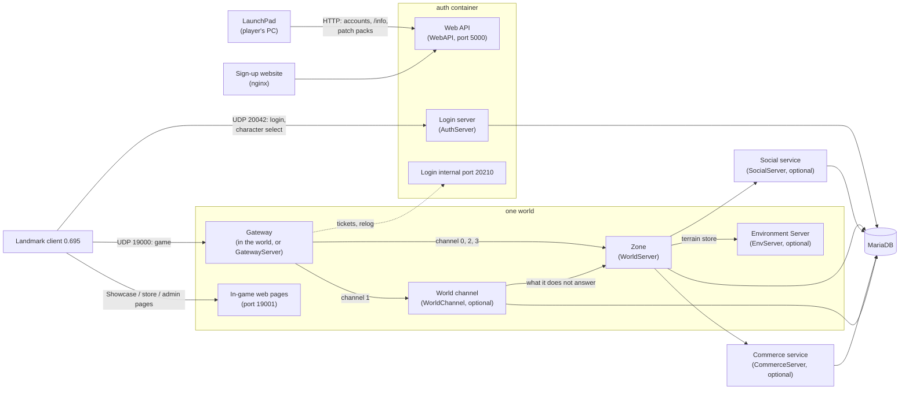

# Code Documentation

LandmarkEmu is one .NET solution, `LandmarkEmulator.sln` (C#, .NET 10), with twenty projects: the server programs,
the libraries they share, the player's launcher, a packet-capture tool and the tests. This page shows how the pieces fit
together; each project has its own page (below). For what each game system does, see `docs/gameplay.md` in the
repository; for the wire formats, [Asset Documentation](Asset-Documentation) and `docs/protocol.md`.

## Architecture

The game client talks to the servers the way it talked to the live Landmark servers: it logs in to a **login server**,
picks a character and is sent to a **world** (a "server" in the game's server list). Inside a world the client's
connection ends at a **gateway**, which routes each packet by its channel to the program that answers it: the **zone**
(the world simulation) for almost everything, or a **world-channel** service for world-level requests. Services shared by
every world (friends and presence, Player Studio and contests) and each world's terrain store can run as programs of
their own.



- **Login** ([AuthServer](Project-AuthServer)): the client's SOE UDP login (accounts, character list, character
  create / delete, server list, the friends shown at character select). The same process hosts the **web API**
  ([WebAPI](Project-WebAPI)) that LaunchPad and the sign-up website use (SRP-6a account creation and login, the
  server's `/info`, the patch folder) and an **internal port** where separate gateways check login tickets.
- **World** ([WorldServer](Project-WorldServer)): the zone. It runs every game system and, by default, everything
  else a world needs in the same process: its gateway ([Gateway](Project-Gateway)), the social and commerce code and
  the terrain store ([EnvServer.Core](Project-EnvServer-Core)). It also serves the in-game web pages (Showcase, store,
  Player Studio, the `/admin` menu).
- **Split services** (optional, "being built"): each in-process part can move to its own container, mirroring how the
  live service was split. The world switches to the remote version when its address setting is set
  (`SOCIAL_ADDRESS`, `COMMERCE_ADDRESS`, `ENVSERVER_ADDRESS`, the gateway override); otherwise the in-process code
  answers, so a single world needs nothing extra.
  - [GatewayServer](Project-GatewayServer): the client-facing UDP port; a routing table of back ends by world, landscape
    and channel; holds connections while a zone restarts; travel between worlds sharing one gateway.
  - [WorldChannel](Project-WorldChannel): channel 1 of a world (trade invitations, duels, build-site likes).
  - [SocialServer](Project-SocialServer): presence, friends, ignore lists, groups, guilds, chat, mail and the Game
    Finder shared by every world.
  - [CommerceServer](Project-CommerceServer): Player Studio, the account store, contests, portraits and Showcase
    following shared by every world.
  - [EnvServer](Project-EnvServer): one world's terrain store (edits, heals, ore veins, Voxel Vision ownership, coarse
    copies, stamps).
- **Internal transport** ([Internal](Project-Internal)): every service-to-service link is a TCP connection carrying
  framed messages (u32 length, one-byte opcode, body). Message classes for each service live in this library, so both
  ends share one definition.
- **Data**: MariaDB / MySQL through EF Core ([Database](Project-Database) and the Auth, Character and Social model
  projects); the commerce and world-channel services keep small schemas of their own. See
  [Database Documentation](Database-Documentation).
- **Game data**: the servers read the client's own data tables and texts from the player's install (copied into
  `server-data/gamedata` by the Docker setup service) through [Shared](Project-Shared). Nothing from the game is in the
  repository.
- **LaunchPad** ([LaunchPad](Project-LaunchPad), [PatchPacks](Project-PatchPacks)): the player's launcher. It creates
  accounts and logs in over the web API, installs the 0.695 update from an `.lmpatch` pack after checking every file
  against built-in SHA-256 hashes, points the client at the server and starts it. The server uses the same PatchPacks
  code to check packs before it offers them. See [LaunchPad](LaunchPad) and [Hosting Patches](Hosting-Patches).

### Who talks to whom

| From | To | How | What |
|---|---|---|---|
| Game client | Login server | SOE UDP (`LOGIN_PORT`) | Login with the session key LaunchPad passes, character select, server list |
| Game client | Gateway | SOE UDP (`WORLD_PORT`), RC4 after the gateway login | Every game packet, wrapped in tunnel packets with a channel byte |
| Game client | World web pages | HTTP (`WEB_PAGES_PORT`) | The in-game browser's Showcase, store and admin pages (signed in by a per-session token) |
| LaunchPad, website | Web API | HTTP (`ACCOUNT_PORT`) | `/srp/register`, `/srp/start`, `/srp/finish`, `/info`, `/patches` |
| Gateway (own process) | Login internal port | Internal TCP (20210) | Consume the single-use server ticket, relog sessions |
| Zone, world channel | Gateway (own process) | Internal TCP (20300) | Register as a back end; attach / close connections; tunnelled packets |
| World channel | Zone | Internal TCP (20310) | Channel-1 packets it does not answer itself |
| Zone | Social / commerce / Environment Server | Internal TCP (20200 / 20400 / 20500) | Service requests and pushes |
| Every server | MariaDB | MySQL protocol (3306 in Docker) | Accounts, characters, worlds, services |

The internal ports are only on the Docker network and are never published. Ports and every other setting:
[Settings Reference](Settings-Reference).

### A login, step by step

1. LaunchPad logs in to the web API with SRP-6a (the password never leaves the PC) and gets a session key. It writes
   the server into the client's `ClientConfig.ini` and starts `Landmark64.exe` with the key.
2. The client logs in to the login server, lists its characters and picks one. The login server issues a single-use
   **server ticket** bound to that world and tells the client the world's address (from the `zone_server` row the
   world keeps up to date).
3. The client connects to the world's gateway and logs in with character id and ticket. The gateway (or the world's
   in-process gateway) consumes the ticket, then attaches the connection to the zone serving the character's landscape.
4. The zone sends the zone details, the character (SendSelfToClient), the item definitions and the world around the
   player; from then on the zone answers the client's packets, and channel-1 packets go to the world channel if one
   is registered.
5. Logging out to character select goes back through a relog session from the login service; travel to another
   landscape of the same world, or to another world on the same gateway, is a re-zone on the same connection.

## Projects

| Project | Kind | What it is |
|---|---|---|
| [LandmarkEmulator.AuthServer](Project-AuthServer) | program | Login server, character select, hosts the web API and the login internal port |
| [LandmarkEmulator.WebAPI](Project-WebAPI) | library | Account and launcher HTTP API, patch folder host |
| [LandmarkEmulator.WorldServer](Project-WorldServer) | program | The world: zone simulation, every game system, in-game web pages |
| [LandmarkEmulator.Gateway](Project-Gateway) | library | SOE session, gateway login, tunnel and channel handling shared by both gateways |
| [LandmarkEmulator.GatewayServer](Project-GatewayServer) | program | The gateway as its own process |
| [LandmarkEmulator.WorldChannel](Project-WorldChannel) | program | A world's channel-1 service |
| [LandmarkEmulator.SocialServer](Project-SocialServer) | program | Shared social service |
| [LandmarkEmulator.CommerceServer](Project-CommerceServer) | program | Shared commerce service |
| [LandmarkEmulator.EnvServer](Project-EnvServer) | program | A world's Environment Server (terrain store) |
| [LandmarkEmulator.EnvServer.Core](Project-EnvServer-Core) | library | The terrain store code, used in-process by the world and by EnvServer |
| [LandmarkEmulator.Internal](Project-Internal) | library | Internal transport and the message classes of every service link |
| [LandmarkEmulator.Shared](Project-Shared) | library | Configuration, networking primitives, cryptography, game data tables and texts |
| [LandmarkEmulator.Database](Project-Database) | library | Database configuration and EF Core provider setup |
| [LandmarkEmulator.Database.Auth](Project-Database-Auth) | library | `lmemu_auth` model and migrations |
| [LandmarkEmulator.Database.Character](Project-Database-Character) | library | `lmemu_character` / `lmemu_world_<key>` model and migrations |
| [LandmarkEmulator.Database.Social](Project-Database-Social) | library | `lmemu_social` model and migrations |
| [LandmarkEmulator.LaunchPad](Project-LaunchPad) | Windows program | The player's launcher |
| [LandmarkEmulator.PatchPacks](Project-PatchPacks) | library | `.lmpatch` packs, the game folder checks and the built-in file lists |
| [LandmarkEmulator.Parser](Project-Parser) | tool | Packet-capture parser for research |
| [LandmarkEmulator.Tests](Project-Tests) | test program | Layout, rule and consistency tests |

## Building and testing

```
dotnet build LandmarkEmulator.sln
dotnet run --project LandmarkEmulator.Tests            # all tests; arguments filter by Class.Method
```

LaunchPad targets `net10.0-windows` (WebView2), so it builds on Windows; everything else builds anywhere .NET 10 runs.
The Docker images are built from `docker/Dockerfile` (one stage per program). See [Contributing](Contributing) for the
project's conventions and [Project Status](Project-Status) for what is built.

## Conventions worth knowing

- **Live behaviour by default.** Every gameplay setting defaults to how live Landmark behaved and stays a server-owner
  toggle; extras beyond live are off. Where live's behaviour is not known, the code and the docs say so.
- **The client is the source of truth.** Packet layouts are the 0.695 client's, numbered as that client numbers them
  (no translation layer). Anything inferred rather than proven is marked as such in the code comments.
- **One world thread.** The zone runs its game systems on one update loop; services hand results back to it rather
  than touching game state from other threads.
- **Settings in three places agree.** A world setting's code default, its compose default and its `.env.example` value
  are kept the same; a test (`LandmarkEmulator.Tests/Config`) checks it.
